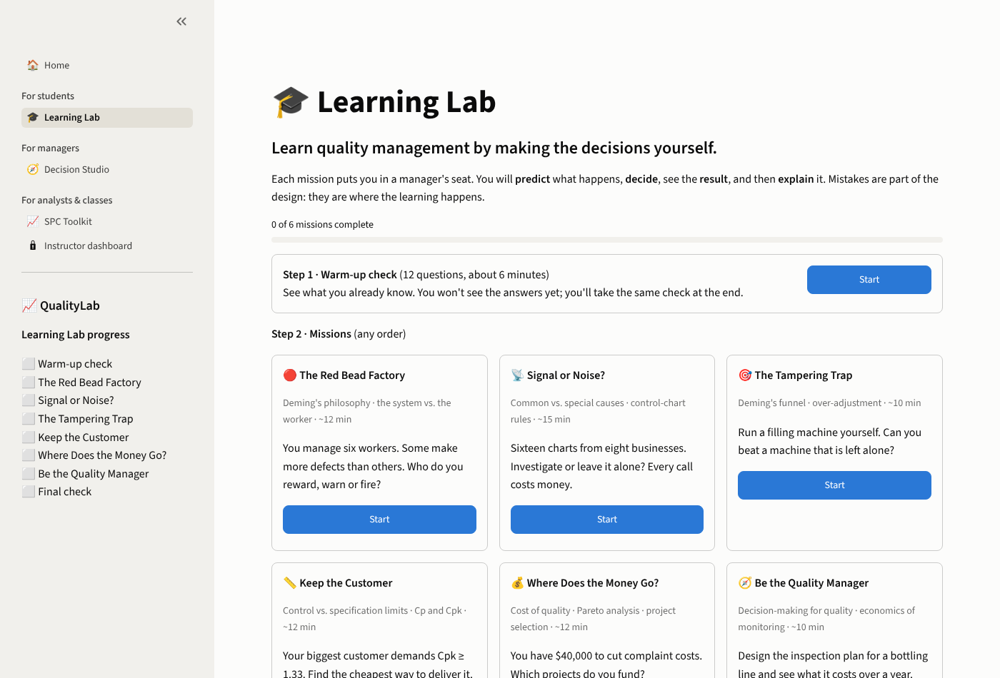
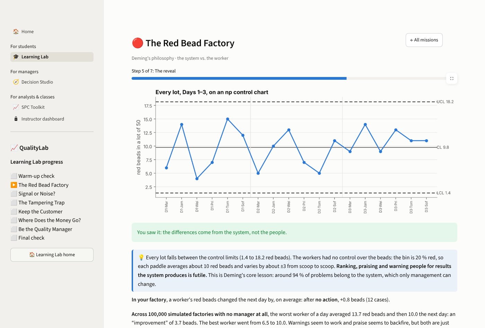
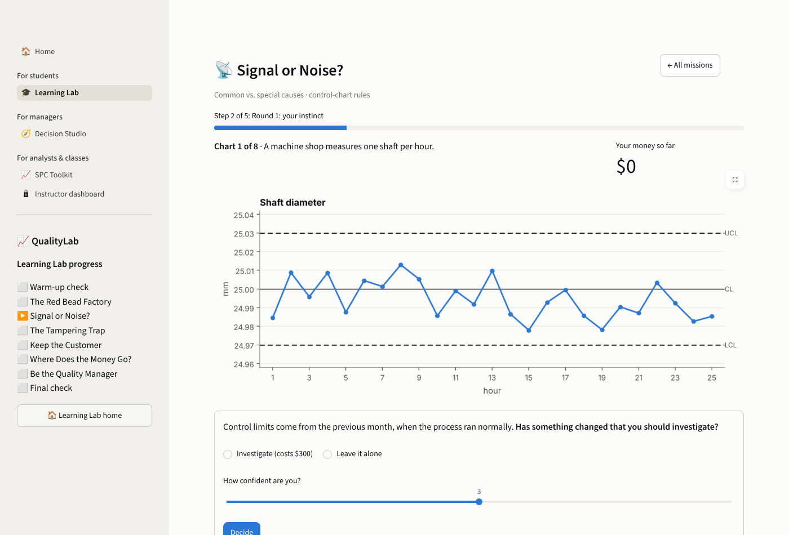
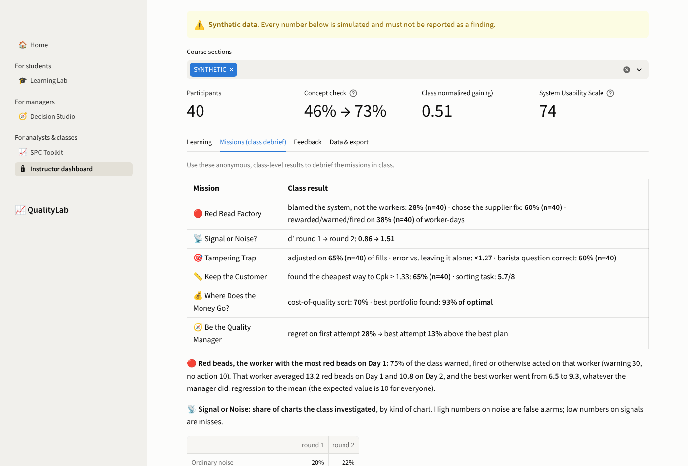
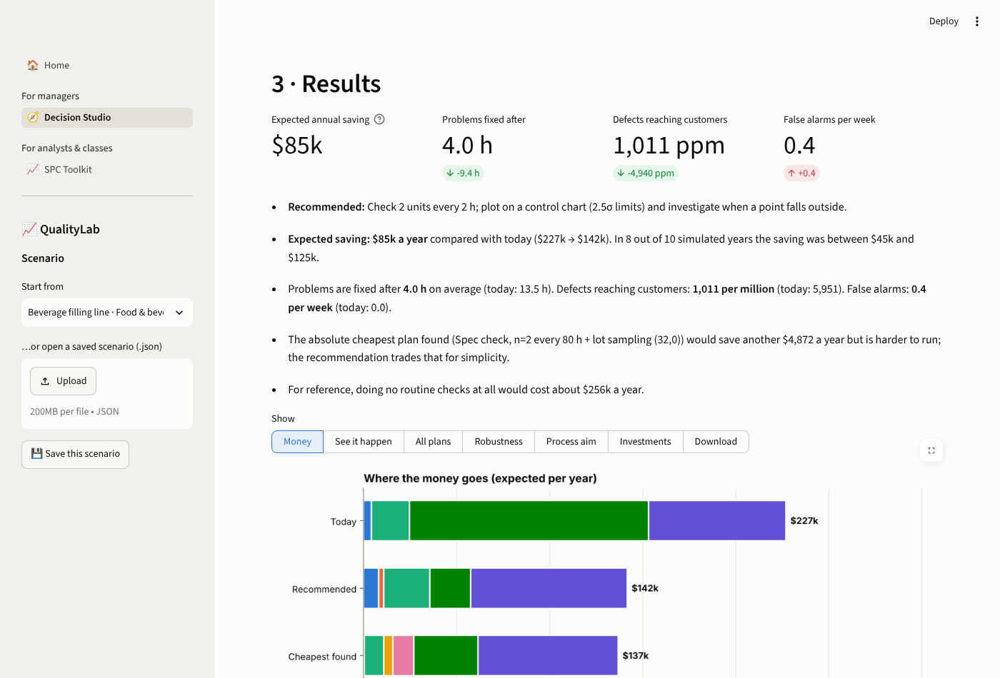
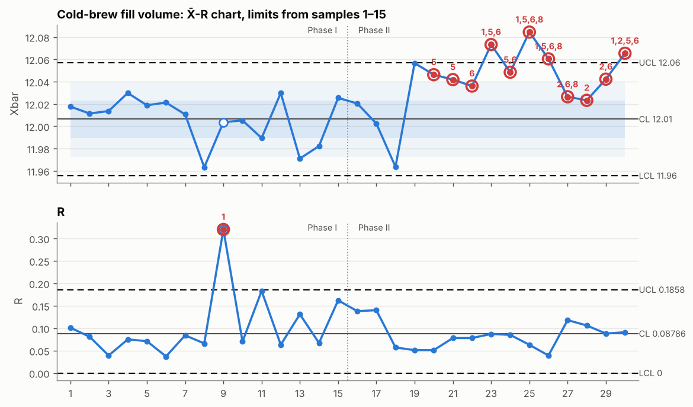
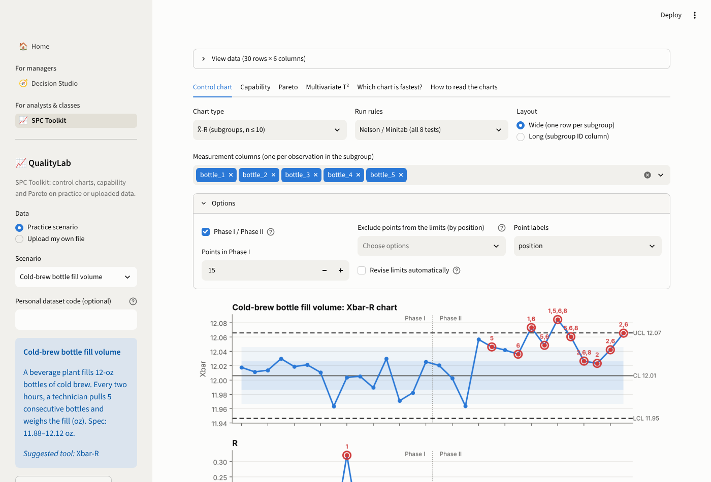
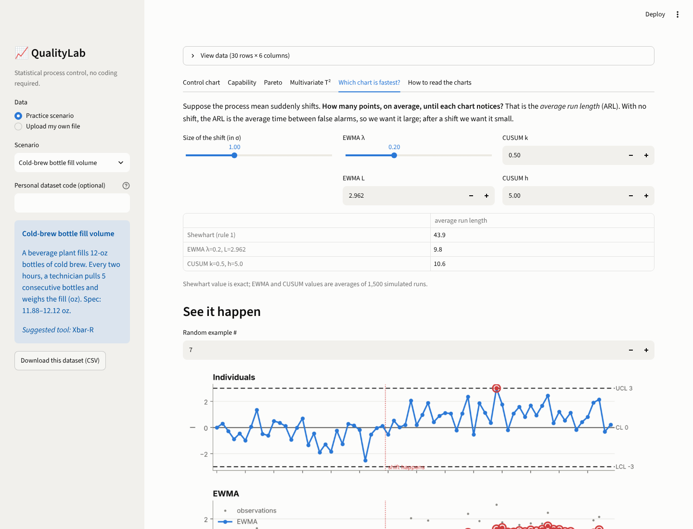

# QualityLab

**Learn quality management by making the decisions. Decide how to watch a process before problems reach your customers. Then run the charts that do the watching.**

[](https://github.com/A0k0f/qualitylab/actions/workflows/ci.yml)


Every operation, from a filling line to a warehouse or an accounts-payable team, faces the same nagging questions: *How often should we check? Is our audit catching anything, or just raising false alarms? Should we inspect everything, sample lots, or neither? Is a new machine worth it?* QualityLab answers them with numbers you can take to a meeting.

It has five parts:

* **🎓 Learning Lab (for students).** Six short missions in which business students make quality decisions and live with the consequences: manage workers in Deming's red bead factory, tell signals from noise on sixteen business charts, run a filling machine by hand, rescue a customer contract with Cp and Cpk, spend a quality budget, and design an inspection plan. Each mission follows *predict → decide → observe → explain*, with a concept check before and after. No statistics background needed. An optional, consent-based **research kit** lets instructors study how much students learn, with an IRB-ready design and anonymous data collection.
* **🧭 Decision Studio (for managers).** Describe a process in plain terms: volume, what goes wrong and how often, what mistakes cost, how you check today. A Monte Carlo simulator replays years of operation under hundreds of monitoring and inspection plans. It recommends the cheapest plan that meets your limits (and a simpler one that is nearly as cheap), with the expected saving and its range. It also tests whether the answer survives if your estimates are off, finds the best process aim (overfill vs. out-of-spec), and prices improvement investments. Six editable industry scenarios are included.
* **📈 SPC Toolkit (for analysts and classes).** Upload data or open a practice scenario and get the right control chart (X̄-R, X̄-S, I-MR, p, np, c, u, Laney p′/u′, EWMA, CUSUM, Hotelling T²) with all eight run rules, capability with confidence intervals, and Pareto, each with a plain-language reading.
* **A tested Python library** behind both (about 100 tests), validated against textbook tables and published run-length results.
* **A case study on a public semiconductor fab dataset** ([SECOM](case_studies/secom/)). It asks whether SPC or machine learning, monitoring 590 sensors, can flag failing wafers, using a leakage-free, time-ordered design.

## Learning Lab



| Mission | Students... | ...and discover |
|---|---|---|
| 🔴 The Red Bead Factory | reward, warn or fire six workers based on their defects, then pick one change to the system | the differences came from the system; the "improvement" after a warning was regression to the mean |
| 📡 Signal or Noise? | decide whether to investigate 16 control charts from 8 businesses, with money on each call, before and after learning the run rules | patterns matter more than single points; their own signal-detection score (d′) |
| 🎯 The Tampering Trap | run a filling machine by hand, then compare Deming's four funnel rules | adjusting a stable process after every unit makes it worse |
| 📏 Keep the Customer | find the cheapest way to reach the Cpk ≥ 1.33 a customer demands | control limits are not specification limits; centering beats buying a new machine; inspection does not create capability |
| 💰 Where Does the Money Go? | classify costs of quality and spend a $40,000 budget on improvement projects | rank problems by cost, not count; the best portfolio is not what rules of thumb pick |
| 🧭 Be the Quality Manager | design a monitoring plan for a bottling line and see its cost over a simulated year | checking is an investment with a measurable return |

| The reveal in the red bead factory | Signal or noise? |
|---|---|
|  |  |

Every "right answer" the missions teach is checked by tests: the red bead distribution and the regression-to-the-mean figures, the funnel rules' theoretical spread, the ground truth of every generated chart under the taught rules (across many seeds), the cheapest capability fix, the exact knapsack optimum for the project budget, and the best monitoring plan. See `tests/test_learn.py`.

**For instructors.** A [teaching guide](labs/learning_lab.md) maps the missions to course objectives and suggests schedules and debrief questions. The **Instructor** page shows anonymous, class-level results for debriefing (e.g. how many students warned the worker with the most red beads, and what happened to that worker the next day).

### Research kit (optional, off by default)

For instructors who want to publish what students learn, the [research kit](docs/research/) provides:

* **Consent-gated, anonymous collection.** Nothing is stored unless the deployment is configured with an IRB protocol number and the student agrees and confirms they are 18 or older. Students who decline get the same Learning Lab. No names, emails, student IDs or IP addresses are collected; students are linked across sessions by a salted hash of a self-generated code.
* **A study design ready to adapt:** pre/post concept check, within-mission decision measures (d′, tampering slope, portfolio optimality, plan regret), confidence calibration, System Usability Scale, and an optional randomised comparison of *predicting first* vs. not.
* **Your own data store:** a Google Apps Script that writes to a Google Sheet you own (or any HTTPS endpoint, e.g. Power Automate).
* **Analysis:** `scripts/analyze_learning_lab.py` produces participant tables, item statistics, paired tests with effect sizes and CIs, ANCOVA for the condition effect, and a short report. It runs on synthetic data out of the box.



## Decision Studio



*Beverage filling line scenario.* Today a technician checks 5 bottles every 4 hours and reacts only if one is out of spec. The simulator recommends checking 2 bottles every 2 hours on a control chart. The expected saving is **≈ $85k a year** (between $45k and $125k in 8 of 10 simulated years). Problems get fixed after 4 hours instead of 13.5, and out-of-spec bottles reaching retailers drop from about 6,000 to about 1,000 per million. Aiming the filler at 12.045 oz instead of 12.10 is worth another ≈ $33k a year in product no longer given away.

| Question a manager has | What the studio shows |
|---|---|
| How often, how many, and what rule? | Cheapest plan among ~120–270 monitoring designs × up to 8 final-inspection options, under your limits on escapes and false alarms |
| Is the audit worth its cost? | Full cost breakdown: checks, false alarms, fixes, scrap, inspection, overfill, defects reaching customers |
| Inspect everything, sample lots, or neither? | 100 % inspection and lot sampling (with OC math) evaluated alongside monitoring |
| What if my numbers are wrong? | Tornado chart: savings and regret with each input at ½× and 1.5× |
| Where should we aim the process? | Cost curve of overfill vs. out-of-spec risk, with the optimum |
| Is the new machine / training / supplier program worth it? | Net annual benefit and payback per investment, re-optimizing the plan for each |
| How do I show my boss? | One-click HTML decision brief, Excel results, saved scenario files |

The engine (`qualitylab.simulate`) is validated against theory: in-control defect rates match closed forms exactly; false-alarm rates and detection delays match Shewhart ARLs; re-aiming after every check reproduces Deming's funnel (variance doubles); lot acceptance matches the binomial OC curve. See `tests/test_simulate.py`.

```python
from qualitylab.scenarios import templates
from qualitylab.decide import optimize, explain

t = templates()["filling"]                       # or build your own Process(...)
d = optimize(t.process, t.current, max_false_alarms_per_week=3)
print("\n".join(explain(d)))
```

## SPC Toolkit



*Limits come from the first 15 samples. The R chart flags sample 9 (one subgroup with a much wider spread), which is excluded and the limits revised. From sample 20 the X̄ chart picks up a sustained upward shift in fill volume, through run rules 5 and 6 before any point crosses a limit. Numbers above points name the rule that fired.*

---

## Why another SPC package?

| | QualityLab |
|---|---|
| **Correct constants** | d2 and d3 come from exact numerical integration of the range distribution (not copied tables), and are checked against Montgomery's Appendix VI and against Monte Carlo |
| **Validated behavior** | Simulated ARLs match the literature: Shewhart 370.4; EWMA (λ=0.2, L=2.962) ≈ 500; CUSUM (k=0.5, h=5) ≈ 465; Western Electric rules ≈ 91.75 |
| **Real-world features** | Unequal subgroup sizes, Laney p′/u′ for huge samples, Phase I/II with excluded points and automatic revision, known-standard limits, one-sided specs |
| **Explains itself** | Every chart can describe its signals in plain language (`qualitylab.interpret.explain`) |
| **Built for teaching** | Seeded business scenarios, so each student gets a different dataset with a known answer key; four ready-to-run [labs](labs/) |

## Install

```bash
git clone https://github.com/A0k0f/qualitylab.git
cd qualitylab
pip install -e ".[app]"          # library + web app (Learning Lab, Decision Studio, SPC Toolkit)
streamlit run app/streamlit_app.py
```

Or use the **[hosted app](https://qualitylab-a0k0f.streamlit.app)** (no install).

## Library quick start

```python
import qualitylab as ql

df = ql.datasets.load("coffee_fill")               # 30 samples × 5 bottles
xbar, r = ql.xbar_r(df.filter(like="bottle"), phase1=15, revise=True)
print(xbar.summary())
xbar.plot()

# attribute data with varying sample sizes; Laney adjustment for huge samples
orders = ql.datasets.load("online_orders")
ql.p_chart(orders.orders_returned, orders.orders_shipped, laney=True).summary()

# capability, with confidence intervals and a plain-language reading
cap = ql.capability(ql.datasets.load("shaft_diameter"), lsl=24.95, usl=25.05)
print(cap.to_frame())
print(cap.interpretation())

# how fast does each chart catch a 1σ shift?
ql.arl.compare(shifts=[0, 0.5, 1, 2])
```

```text
Xbar chart: 30 points, limits from 14 (Phase I = first 15, 1 excluded)
  CL = 12.0064
  UCL = 12.057   LCL = 11.9557
  Rule 1 (point beyond a control limit): 23, 25, 26, 30
  Rule 2 (run of points on one side of the center line): 27, 28, 29, 30
  ...
```

| Function | What it does |
|---|---|
| `xbar_r`, `xbar_s`, `imr` | Variables charts; return (location, dispersion) results |
| `p_chart`, `np_chart`, `c_chart`, `u_chart` | Attributes charts; `laney=True` for p′ / u′ |
| `ewma`, `cusum` | Time-weighted charts for small, sustained shifts |
| `hotelling_t2` | Multivariate T² (Phase I beta / Phase II F limits; sample or successive-difference covariance) |
| `capability` | Cp, Cpk, Pp, Ppk, Cpm, CIs, PPM (observed / within / overall), normality test, Z.bench |
| `pareto` | Sorted frequencies, cumulative share, "vital few" |
| `rules.evaluate` | Nelson rules 1–8 on any series (presets: `nelson`, `western_electric`, `attribute`, `limits`) |
| `arl` | Exact and simulated run-length distributions |
| `datasets` | Nine seeded business scenarios, with answer keys |
| `simulate` | What-if engine: processes, failure modes, monitoring & inspection policies, Monte Carlo costs |
| `decide` | Plan optimizer, robustness (sensitivity), process aim, investment ROI, calibration from data |
| `scenarios` | Six editable industry templates for the Decision Studio |

Every chart returns a `ChartResult` with `.statistic`, `.center`, `.ucl`, `.lcl`, `.violations`, `.to_frame()`, `.summary()` and `.plot()`.

## The SPC Toolkit app

| Control chart with interpretation | Which chart is fastest? |
|---|---|
|  |  |

* **Practice scenarios:** cold-brew filling, call-center waits, invoice errors, e-commerce returns, circuit-board defects, hotel complaints, complaint reasons, shaft diameters and a bottling line. Each comes with a story and a suggested tool.
* **Personal dataset code:** typing a code gives a student their own version of a scenario, so answers can't be copied.
* **Upload your own CSV/Excel:** wide or long subgroup layouts and attribute data are supported. Files are processed in the session only.
* **Exports:** charts as PNG, results as Excel.
* **ARL simulator:** shows why EWMA and CUSUM beat a Shewhart chart on small shifts, and what supplementary run rules cost in false alarms.

## Case study: SECOM semiconductor fab

> At a fixed 5% false-alarm budget, a per-sensor control chart caught 18% of failing wafers in a later period, ahead of Hotelling T², Isolation Forest and a supervised classifier. None of the methods was reliably better than chance. The monitoring did reveal a process change in late September that left yield unaffected.

[Read the full case study →](case_studies/secom/)

## Testing

```bash
pip install -e ".[dev]"
pytest -m "not slow"   # ~160 fast tests, including full headless playthroughs of the Learning Lab
pytest -m slow         # Monte Carlo ARL checks against published values
```

## Project layout

```text
src/qualitylab/        library (charts, rules, capability, multivariate, ARL, datasets, simulate, decide, plotting)
src/qualitylab/learn/  Learning Lab engines (red beads, signals, funnel, capability, Pareto, manager, concept check)
src/qualitylab/research*.py  consent-gated logging and analysis for the research kit
app/                   Streamlit app: Home, Learning Lab, Decision Studio, SPC Toolkit, Instructor dashboard
case_studies/secom/    case study on a public semiconductor dataset
labs/                  Learning Lab teaching guide and four classroom labs
docs/research/         research kit: setup, study design, consent template, data dictionary, Apps Script
tests/                 unit, validation and end-to-end app tests
scripts/               analysis of Learning Lab data; regenerates the d2/d3 constants table
```

## References

* Deming, W. E. (1986). *Out of the Crisis*. MIT Press. (Red beads, the funnel.)
* Goetsch, D. L. & Davis, S. B. *Quality Management for Organizational Excellence: Introduction to Total Quality* (9th ed.). Pearson.
* Hake, R. R. (1998). Interactive-engagement versus traditional methods. *American Journal of Physics* 66(1).
* Brooke, J. (1996). SUS: a "quick and dirty" usability scale. In *Usability Evaluation in Industry*. Taylor & Francis.
* Montgomery, D. C. *Introduction to Statistical Quality Control* (8th ed.). Wiley.
* Nelson, L. S. (1984). The Shewhart control chart: tests for special causes. *Journal of Quality Technology* 16(4).
* Lucas, J. M. & Saccucci, M. S. (1990). Exponentially weighted moving average control schemes. *Technometrics* 32(1).
* Laney, D. B. (2002). Improved control charts for attributes. *Quality Engineering* 14(4).
* Sullivan, J. H. & Woodall, W. H. (1996). A comparison of multivariate control charts for individual observations. *Journal of Quality Technology* 28(4).
* Champ, C. W. & Woodall, W. H. (1987). Exact results for Shewhart control charts with supplementary runs rules. *Technometrics* 29(4).
* Lorenzen, T. J. & Vance, L. C. (1986). The economic design of control charts: a unified approach. *Technometrics* 28(1).
* Schilling, E. G. & Neubauer, D. V. *Acceptance Sampling in Quality Control*. CRC Press.

## License

MIT © 2026 Ali Karamifard. Practice datasets are simulated. SECOM data © the original authors, CC BY 4.0, downloaded at run time.
