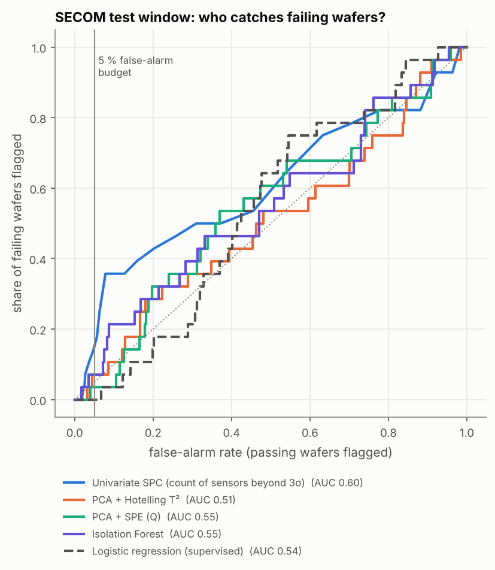
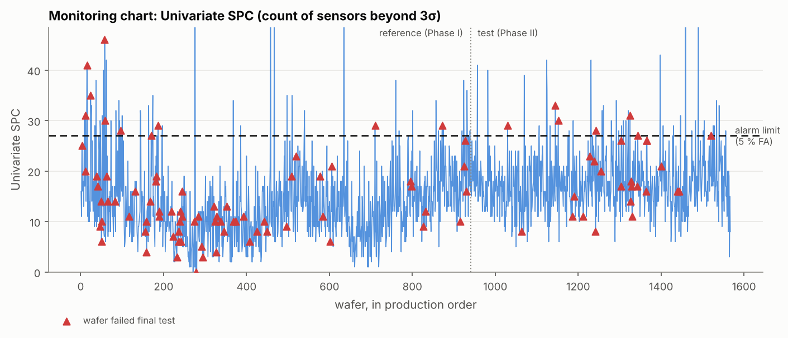
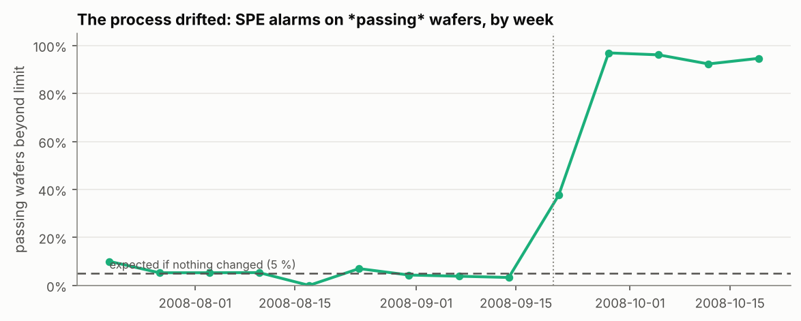
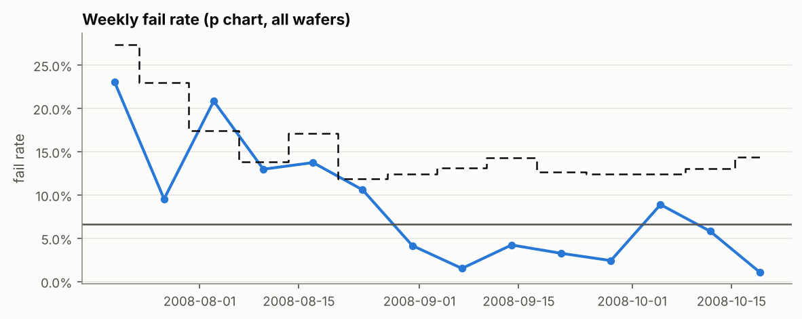

# Case study: monitoring a semiconductor fab with SPC and machine learning

**Question.** A wafer fab logs 590 sensor readings for every wafer while it is being made. Final test happens later. Could monitoring those in-process readings (with control charts or anomaly detection) flag the wafers that will fail, early enough to act?

**Data.** [UCI SECOM](https://archive.ics.uci.edu/dataset/179/secom) (McCann & Johnston, 2008; CC BY 4.0): 1,567 wafers, 19 Jul–17 Oct 2008, 590 sensors, 104 failures (6.6%). The script downloads the data from UCI. The data are not redistributed here.

**Short answer.** Not reliably. The best method, an individuals chart on every sensor, caught 18% of the failing wafers in the test period at a 6% false-alarm rate. No method's ROC AUC was clearly above chance (all 95% CIs include 0.5). What the monitoring *did* show clearly was that **the process itself changed in late September**: by October, 94% of *passing* wafers were outside the multivariate limits set on July–September data, yet the failure rate stayed low. In a high-dimensional process, "the process changed" and "the product got worse" are different questions, and a control chart answers only the first.

## Design

Most published SECOM analyses shuffle the wafers randomly, impute and select features on the full dataset, and tune on the evaluation data. All three leak information that a real fab would not have. This study avoids that:

| Choice | Why |
|---|---|
| Chronological split: first 60% of wafers = reference (Phase I), last 40% = test (Phase II) | A monitoring system only ever sees the past |
| Preprocessing (drop >50%-missing and constant sensors, median imputation, scaling) fit on the reference window only | No information from the future |
| Monitoring models fit on *passing* reference wafers | That is what a control chart does: it models normal operation |
| Alarm limit = the score that 5% of passing reference wafers exceed, fixed before looking at the test window | A false-alarm budget, chosen up front as a plant would |
| 2,000-sample bootstrap CIs; split at 50/60/70% as a robustness check | 28 test failures is a small sample |

**Methods compared**

1. **Univariate SPC.** An individuals chart per sensor, with ±3σ limits (σ from the average moving range). Wafer score = number of sensors beyond their limits.
2. **PCA + Hotelling T².** T² on the 120 principal components that explain 90% of reference variance.
3. **PCA + SPE (Q).** The squared residual off that PCA model, which catches changes in the correlation structure.
4. **Isolation Forest.** Unsupervised anomaly detection.
5. **Logistic regression (supervised baseline).** L2-regularized and class-weighted, trained on the reference labels.

## Results (test window: 627 wafers, 28 failures)

| Method | ROC AUC (95% CI) | Fails caught | False alarms on passing wafers | Precision |
|---|---|---|---|---|
| Univariate SPC (count of sensors beyond 3σ) | **0.60** (0.47–0.73) | **18%** | 5.7% | **13%** |
| PCA + Hotelling T² | 0.51 (0.39–0.62) | 11% | 9.8% | 5% |
| PCA + SPE (Q) | 0.55 (0.43–0.66) | 96% | **94%** | 5% |
| Isolation Forest | 0.55 (0.44–0.67) | 11% | 7.2% | 7% |
| Logistic regression (supervised) | 0.54 (0.44–0.63) | 4% | 7.2% | 2% |

Base rate of failure in the test window: 4.5%. ROC AUC by split point (reference = first 50% / 60% / 70%): univariate SPC 0.58 / 0.60 / 0.63, the best or tied-best each time; every other method stayed between 0.43 and 0.59.



### Finding 1: the simplest method held up best, but none is a usable early-warning system

Counting how many sensors are out of limits beat both the multivariate statistics and machine learning, at every split point. Its advantage is modest, though, and uncertain: at the 5% false-alarm budget it caught about 1 in 6 failing wafers, and its alarms were right about 1 time in 8. With 590 sensors and 104 failures, a supervised model has far more ways to overfit than examples to learn from. That shows here: logistic regression trained on the reference labels did no better than chance in the test period.



### Finding 2: the process changed in late September, and yield did not

A model of "normal" built on July to mid-September flagged almost every wafer from the week of 21 September onward:



The change is broad: 13 sensors moved by more than one reference standard deviation. The largest movers, sensors 542–545, had weekly medians that did not change for two months and then started to vary. That is consistent with a recipe, calibration or maintenance change, though the data cannot say which. Meanwhile the weekly failure rate, which was high in the first weeks of the record, stayed low:



Two lessons follow:

* **A Phase I model has a shelf life.** After a known, accepted change, the limits must be re-established. Otherwise the chart cries wolf on 94% of wafers, operators learn to ignore it, and the next real problem goes unnoticed.
* **Standardizing near-constant sensors magnifies tiny changes.** Sensor 542 moved from 0.110 to about 0.113. That is trivial in engineering terms but several reference standard deviations. Engineering tolerances, not just statistical spread, should decide which sensors to monitor.

### Data-quality note

A CSV copy of SECOM that circulates on GitHub (`uci-secom.csv`) has the day and month swapped in 582 of 1,567 timestamps (5 August becomes "2008-05-08"). If you sort by those dates, the production order is scrambled. The loader detects and repairs this using the row order, which follows production time.

## Reproduce

```bash
pip install -e ".[case-study]"
python case_studies/secom/secom_case_study.py                    # downloads from UCI
python case_studies/secom/secom_case_study.py --data uci-secom.csv  # or a local copy
```

The script writes `results/metrics.csv`, `results/robustness_auc.csv`, `results/meta.json` and the four figures. It takes a minute or two on a laptop.

## Limitations

* Only 28 failures fall in the test window, so the CIs are wide. A different fab, product or period could tell a different story.
* SECOM's sensors are anonymous. Without engineering knowledge of what each one measures, sensor selection and the interpretation of the September change are necessarily statistical.
* Final-test failures may be driven by steps that SECOM's sensors do not observe. Weak prediction is then a property of the data, not of the methods.

## Reference

McCann, M. & Johnston, A. (2008). *SECOM* [Dataset]. UCI Machine Learning Repository. https://doi.org/10.24432/C54305
